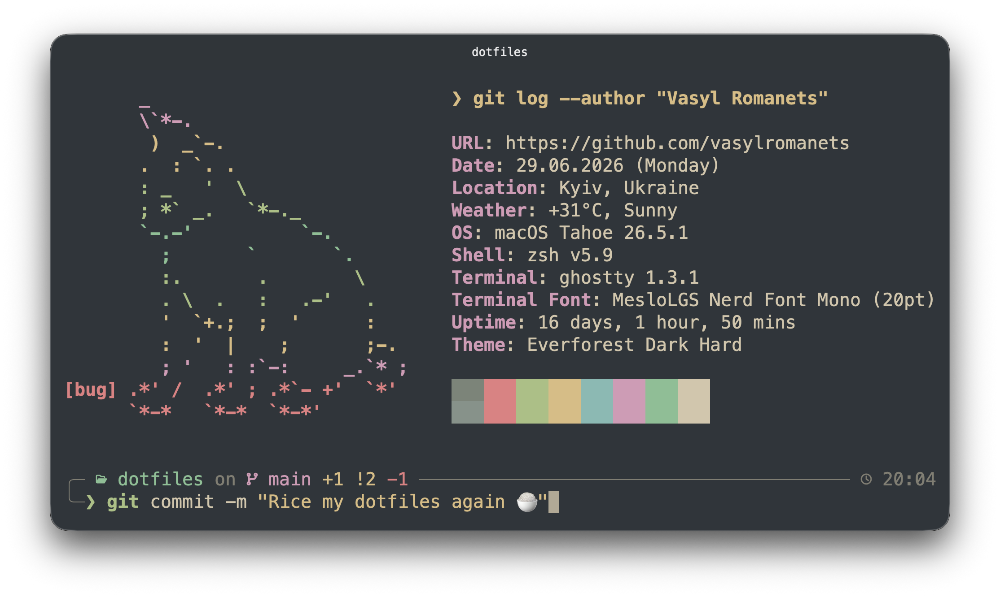
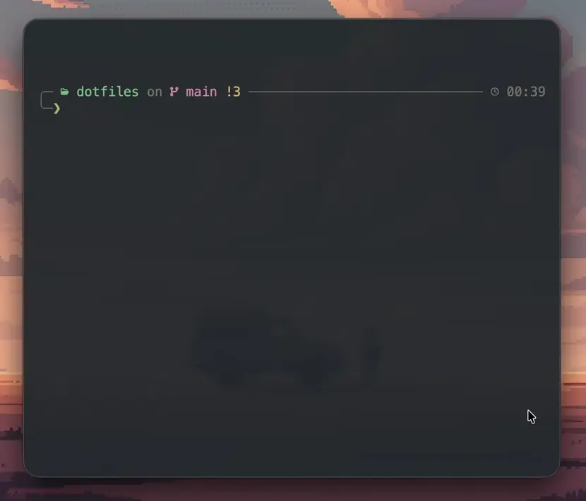

# dotfiles

My personal macOS dotfiles crafted with love. Review the installation scripts and package files before adopting.

<p align="center">
  
</p>

## Structure

```
dotfiles/
├── Brewfile                # Homebrew formulae, casks, cargo crates, and App Store apps
├── install.sh              # one-step installer: clones the repo and runs scripts/bootstrap.zsh
├── packages/
│   └── <pkg>/
│       ├── link/           # files to symlink (optional)
│       ├── source/         # <pkg>.zsh sourced from ~/.config/zsh/source/ (optional)
│       ├── copy/           # files to copy (optional)
│       ├── hooks/          # pre-sync.zsh, post-sync.zsh, theme-changed.zsh (optional)
│       ├── templates/      # Mustache templates dots build-themes renders per scheme (optional)
│       └── sync.toml       # install conditions and copy/link target (optional)
└── scripts/
    ├── _lib.zsh            # shared utilities
    ├── bootstrap.zsh       # full machine setup
    ├── sync.zsh            # symlinks package files and copies assets
    ├── unlink.zsh          # removes a package's symlinks
    ├── pull.zsh            # fast-forwards the repo from its remote
    ├── build-themes.zsh    # renders every theme's per-tool files from packages/theme/schemes
    ├── prune-symlinks.zsh  # removes orphaned symlinks left by renamed/removed package files
    └── macos.zsh           # sensible macOS defaults
```

## New Machine Setup

Paste this into Terminal. It asks before each step:
```sh
sh -c "$(curl -fsSL https://raw.githubusercontent.com/VasylRomanets/dotfiles/HEAD/install.sh)"
```

This will:
- Clone the repo to `~/.dotfiles`
- Install Xcode Command Line Tools
- Install Homebrew
- Install formulae, casks, cargo crates, and App Store apps from Brewfile
- Symlink package files and copy assets
- Configure SSH and Git
- Apply macOS defaults

To skip the questions, add `sh --yes` at the end of the command (`scripts/bootstrap.zsh --help` lists the options).

<p align="center">
  
</p>

## Updating

Once the bootstrap has run, everything goes through the `dots` command (`dots help` lists it). `sync`, `unlink` and `pull` take `-n` to preview:
```zsh
dots sync [package…]   # link package files; -v also lists unchanged files
dots pull [--sync]     # fast-forward the repo (refuses on uncommitted changes), optionally syncing after
dots unlink <package>  # remove a package's links
dots prune-symlinks    # clean up stale links left by renamed or removed package files
```

To keep some packages off a machine, list them in `~/.config/dots/config.toml` (not part of the repo), then run `dots unlink` for any that are already linked:
```toml
deny = ["ghostty"]        # never sync these
allow = ["atuin", "bat"]  # or: sync only these (deny wins over allow)
```

## Package Setup

Each package may optionally include a `sync.toml`. Packages without one are always processed, symlinking `link/` to `~` by default.

```toml
# Skip this package if the CLI tool/GUI app is not installed
[requires]
command = "bat"  # checked via command -v
app = "Ghostty"  # checked via /Applications/Ghostty.app

# Override symlink destination (defaults to ~)
[link]
target = "~"

# Copy files from copy/ to this directory
[copy]
target = "~/Library/..."
```

`[requires]` accepts `command`, `app`, or both. `[copy]` is for packages that can't be symlinked because of macOS sandboxing (e.g. Mac App Store apps). Optional `hooks/pre-sync.zsh` and `hooks/post-sync.zsh` handle steps beyond linking, such as resolving plugins, and run only for packages that pass `[requires]`.

## Themes

`theme` switches the color theme of the terminal and the CLI tools in one go (`theme --help` lists everything):
```zsh
theme         # pick one with a live preview
theme <name>  # apply a theme directly
theme toggle  # switch to the dark or light counterpart
theme random  # apply a random theme
theme list    # print every available theme
```

Each theme is a small TOML scheme in `packages/theme/schemes`. `dots build-themes` renders the per-tool files from it, and the results are committed, so `dots sync` doesn't need to build anything.
